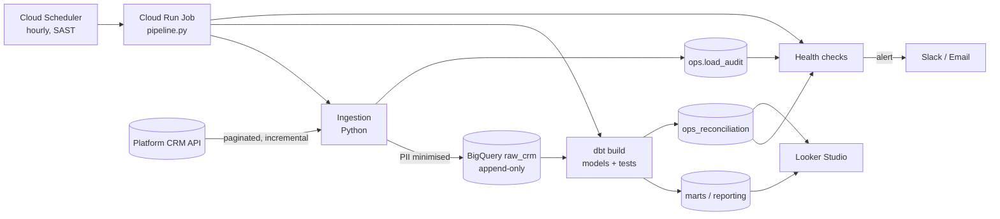

# iGaming Reporting Pipeline: CRM API → BigQuery → dbt → Looker Studio

A working reference implementation of an automated reporting stack for an online betting
operator: raw player-platform data pulled from an API, landed in BigQuery with POPIA-compliant
handling, modelled into trusted iGaming KPIs with dbt, **reconciled against the platform's own
figures**, monitored with alerts, and served to Looker Studio in a form the internal team can
extend without a developer.

It runs end to end on your laptop against a realistic mock platform API and synthetic data
(DuckDB stands in for BigQuery locally; the same dbt project targets both).

```bash
make install
make demo            # mock API → ingest → dbt build (43 models/tests) → health checks → dashboard preview
make demo-mismatch   # drop 5 bets from one day and watch reconciliation catch it and alert
make docs            # dbt lineage graph + data dictionary
```

Open `docs/dashboard_preview.html` for a preview of the report pages.

### Or with Docker (nothing to install except Docker)

```bash
docker compose up --build --abort-on-container-exit --exit-code-from pipeline
```

This starts the mock platform API, waits until it's healthy, runs the full pipeline, and writes
`output/warehouse.duckdb` and `output/dashboard_preview.html` to your machine. Also available:
`make docker-mismatch` (data-loss simulation) and `docker compose --profile docs up docs`
(dbt lineage and data dictionary at http://localhost:8080).

---

## How this maps to the brief

| Requirement | Where it lives |
|---|---|
| Pull raw data from the platform API into BigQuery | `ingestion/`: paginated, incremental (watermark + overlap window), retries with backoff on 429/5xx, append-only raw tables with batch IDs |
| Clean, structure and model the data | `dbt/models/`: staging (dedupe, typing, SAST dates) → intermediate → marts → reporting |
| Automated reports in Looker Studio | `dbt/models/reporting/` tables + `docs/looker_studio_guide.md` (pages, fields, calculated metrics) |
| Internal team can build future reports without developers | `rpt_player_activity_daily`: one wide, pre-joined, documented table; column descriptions pushed into BigQuery so they show in Looker Studio |
| Validate figures against source | `ops_reconciliation` compares every closed day with the platform's own back-office report; `assert_marts_reconcile_to_staging` catches modelling errors; KPI identity tests |
| Monitoring and alerts | `ops.load_audit` + `ops_load_health`; `monitoring/check_and_alert.py` → Slack/Teams/Google Chat webhook + Cloud Monitoring email |
| POPIA | Direct identifiers never land; email/mobile stored only as keyed HMAC; DOB → birth year; data kept in `africa-south1`; reporting users can read only the `reporting` dataset (`docs/popia.md`) |
| Python, dbt, Cloud Scheduler | Cloud Scheduler → Cloud Run Job (`Dockerfile`, `deploy/setup_gcp.sh`) |
| Operator owns everything | Deploys into their project; secrets in their Secret Manager; no key files; no vendor-hosted components |
| Documentation and handover | `docs/`: architecture, metric definitions, runbook, Looker Studio guide, handover checklist |

## Architecture



## Repository layout

```
ingestion/          API client, source contract (endpoints.py), POPIA rules, BigQuery/DuckDB loaders
dbt/
  models/staging/   1:1 with sources: dedupe to latest record, type money as NUMERIC, SAST dates
  models/intermediate/  player-day activity (union-then-aggregate: no join fan-out)
  models/marts/     dim_players, fct_player_daily, fct_daily_kpis
  models/reporting/ Looker Studio sources (rpt_*)
  models/ops/       ops_reconciliation, ops_load_health
  tests/            reconciliation + accounting identity tests
monitoring/         post-run checks and alerting
deploy/             GCP setup script, alert policy, access grants
mock_crm/           realistic mock platform API + synthetic data generator
docs/               handover documentation
```

## Design decisions worth knowing

- **One definition per metric.** GGR, NGR and bonus cost are calculated once in dbt (`macros/metrics.sql`), never in dashboards, so two reports can't disagree. NGR deductions (provincial levy, VAT treatment) and which bonus events count as cost are config variables to agree with finance.
- **Reporting day = SAST.** All timestamps are UTC in raw; dates are converted to Africa/Johannesburg in staging so "yesterday's GGR" matches the back office.
- **GGR on settlement date.** Open sportsbook bets aren't revenue yet; a bet placed Saturday and settled Monday counts on Monday.
- **Append-only raw + dedupe in staging.** Every load is kept and traceable to a batch; restated records simply supersede older versions.
- **Failures don't advance the watermark.** A failed load is re-pulled automatically on the next run, and an overlap window catches late updates.
- **Money is never FLOAT.** NUMERIC/DECIMAL end to end.
- **Additive measures in reporting tables.** Ratios (hold %, ARPU, average deposit) are Looker Studio calculated fields over sums, so they're correct at any grain.

## Adapting to the operator's platform

Only `ingestion/endpoints.py` (paths, fields, watermark columns, PII rules) and the staging
models change. See `docs/adapting_to_a_new_platform.md`.
